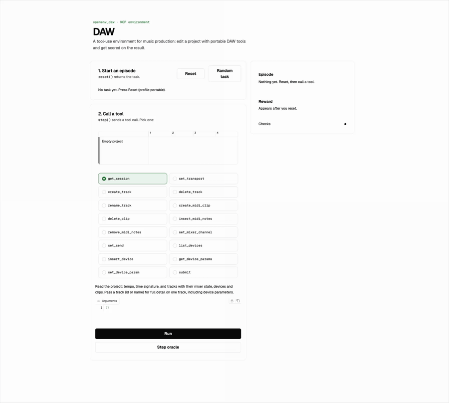

# openenv-daw

**Teach an AI agent to use a digital audio workstation.** An [OpenEnv](https://github.com/openenv/OpenEnv)
environment where an agent gets a plain-language request ("add a 4-bar melody in D minor on a new
track called Lead") and has to carry it out with DAW tools, then gets scored on the result.



*The DAW Studio web UI: start a task, call tools by hand or step the oracle, and watch the checks
and reward update.*

## Why use it

- **Train abstract, deploy specific.** The agent learns one portable tool set. Adapters map it to
  Ableton Live 12, REAPER 7, Bitwig and Ardour.
- **Fast and deterministic.** A pure-Python simulator, no audio engine, no DAW needed. The same
  seed gives the same task and the same state hash.
- **Verifiable rewards.** Every task has checks and an oracle solution that scores 1.0, so a
  reward bug shows up as a failing test.
- **Ready for RL and SFT.** A TRL environment and a 242-task held-out benchmark are
  included.

## Try it in 60 seconds

Install the [OpenEnv](https://github.com/openenv/OpenEnv) CLI (`pip install openenv`), then from this
folder:

```bash
uv sync --extra server --extra ui     # once
ENABLE_WEB_INTERFACE=true uv run server
```

Open <http://localhost:8000/web> and use the **DAW Studio** tab:

1. Press **Reset** (or **Random task**) to get a request.
2. Pick a tool, edit its arguments and press **Run**, or press **Step oracle** to watch the
   reference solution.
3. Watch the **Checks** and the **reward if you submit now**, then call `submit`.

`uv run server` runs on the host. To run in a container instead:

```bash
docker build -f server/Dockerfile -t openenv-daw .
docker run -p 8000:8000 -e ENABLE_WEB_INTERFACE=true openenv-daw
```

## Use it from Python

```bash
pip install openenv-daw
```

```python
from openenv_daw.client import DawEnv

with DawEnv(base_url="http://localhost:8000").sync() as env:
    r = env.reset(task_id="mix_balance-train-0")  # or split="train", seed=0
    print(r.observation.intent)  # wording varies, e.g. "Turn Lead down to -3 dB and pan Pad fully right."
    env.call("get_session")  # the agent must look at the project first
    env.call("set_mixer_channel", track="Lead", volume_db=-3)
    env.call("set_mixer_channel", track="Pad", pan=1.0)
    r = env.call("submit", status="done")
    print(r.reward, r.observation.metadata["success"])  # 1.0 True
```

Tasks are also listed over HTTP (the Task API): `env.list_splits()`, `env.num_tasks("heldout")` and
`env.get_task_range("heldout", 0, 10)`, and `env.reset(split="heldout", index=12)` runs one of them.

Use `async with DawEnv(...) as env:` and `await env.reset(...)` / `await env.call(...)` in async
code. To start a deployed Space image locally: `DawEnv.from_env("<user>/openenv-daw")`.

## What the agent can do

17 portable tools plus `submit`. Every result is JSON, and errors are typed (`not_found`,
`invalid_args`, `conflict`, `unsupported`, `execution_error`).

| Area | Tools |
|---|---|
| Project | `get_session`, `set_transport` |
| Tracks and clips | `create_track`, `delete_track`, `rename_track`, `create_midi_clip`, `update_midi_clip`, `delete_clip` |
| Notes | `insert_midi_notes`, `remove_midi_notes` |
| Mixing | `set_mixer_channel`, `set_send` |
| Sounds and effects | `list_devices`, `insert_device`, `delete_device`, `get_device_params`, `set_device_param` |
| Finish | `submit` (`done`, or `blocked` when the request is impossible) |

Tasks come in families, from simple to compositional:

| Family | Example request |
|---|---|
| `session_setup` | Switch the time signature to 7/8 and set 135 beats per minute. |
| `mix_balance` | Set Lead to -9 dB, pan Pad hard right, and mute Drums. |
| `melody_in_key`, `chord_progression`, `four_on_floor_beat` | Musical writing, checked for key, harmony and rhythm. |
| `edit_notes`, `device_tweak`, `reverb_send`, `load_sound` | Change existing material, tweak a device, add a send, load a described sound. |
| `remove_device`, `clip_edit` | Remove or swap a device (racks and plugins cannot be removed); rename, move, resize or trim a clip. |
| `disambiguation`, `near_miss` | Duplicate names; requests that only sound impossible. |
| `compositional` | Chains of 2 to 3 of the above. |
| `infeasible` | About 10% of tasks: the right answer is `submit("blocked")`. |

Difficulty tags `L1` to `L3`. Train tasks are generated from seeds; the held-out set
`heldout.jsonl` has 242 tasks with unseen templates and values.

## How scoring works

1. **Gates.** Any failed critical check, a wrong submit status, no `submit` at all, or changing an
   object the task did not declare touchable scores 0.
2. **Correctness.** The fraction of remaining checks passed, scaled down for extra objects the task
   did not ask for (15% each, at most 50%) and for tool errors (2% each, at most 20%).
3. **Musicality.** For musical tasks, 20% of the reward is a soft musicality score (melody shape,
   voice leading, rhythm). It counts only after the gates pass and never changes `success`.

`metadata["success"]` is binary and about correctness only.
Details: [docs/design.md](https://github.com/gabguerin/openenv-daw/blob/main/docs/design.md#scoring).

## Train with TRL

`openenv_daw.trl_env.DawToolEnv` is a TRL `environment_factory` class built from the same tool
registry (reward from `get_reward`), and `build_dataset` makes its prompts from the train or
held-out split. It runs the simulator in-process, so it trains at simulator speed.

```python
from trl import GRPOConfig, GRPOTrainer
from datasets import Dataset
from openenv_daw.trl_env import DawToolEnv, build_dataset

trainer = GRPOTrainer(
    model="Qwen/Qwen3-1.7B",
    train_dataset=Dataset.from_list(build_dataset("train", n=512)),
    environment_factory=DawToolEnv,  # tools and reward come from the environment
    args=GRPOConfig(output_dir="daw-grpo", max_completion_length=2048),
)
trainer.train()
```

| Path | steps/s (Apple M-series) |
|---|---|
| Simulator ops only | ~22,000 |
| Environment, in-process | ~240 |
| Environment over WebSocket (Docker) | ~270 |

## Benchmark and baselines

The held-out split (`split="heldout"`, 242 tasks, 15 families, levels `L1` to `L3`) uses templates
and values that never appear in `train`; 29 tasks (12%) are infeasible, so the right answer is
`submit("blocked")`. Scripted policies bound the scale:

| Policy | Success | Mean reward |
|---|---|---|
| Oracle (reference solution) | 242/242 | 1.000 |
| Do nothing | 0/242 | 0.000 |
| `submit("done")` without edits | 0/242 | 0.000 |
| `submit("blocked")` always | 29/242 (12.0%) | 0.120 |

No feasible task is solved by doing nothing, and every oracle scores 1.0. As a learned reference, a
LoRA-SFT `LFM3-1.7B` student solved 102/212 (48.1%) of an earlier 212-task version of this split
(95% CI 41.5% to 54.8%): near-perfect on `session_setup`, `near_miss` and `mix_balance`, but 0% on
`melody_in_key` and `chord_progression`. Part of that was the key split: v7 trained on natural-note
keys only and held out sharps and flats, so v8 trains on 20 keys and holds out four unseen ones.

## Deploy and share

All with the `openenv` CLI:

```bash
openenv validate --level static --skip-build        # fast manifest check
openenv validate --level runtime                    # builds the image and runs the contract checks
openenv validate --url http://localhost:8000        # probe a running server
openenv push --repo-id <you>/openenv-daw --hardware cpu-basic --exclude .hfexclude
openenv fork <owner>/openenv-daw                    # copy a deployed Space to your account
```

The web UI runs on a `cpu-basic` Space (Docker Spaces on `cpu-basic` need a Hugging Face PRO
account). Its "Run a model" card talks to any OpenAI-compatible chat endpoint: locally it defaults
to `OPENENV_DAW_MODEL_URL` (`http://127.0.0.1:8080/v1`), `OPENENV_DAW_MODEL` (`default_model`) and
optional `OPENENV_DAW_MODEL_KEY`; on the Space it calls Hugging Face Inference Providers using the
visitor's own Sign in with Hugging Face token, so inference is billed to the visitor. The
`space-openenv-daw` workflow runs the same `push`. The image is built on `openenv-base` with
dependencies from `uv.lock`. To use a deployed Space from Python,
`pip install git+https://huggingface.co/spaces/<owner>/openenv-daw` and
`DawEnv.from_env("<owner>/openenv-daw")`.

## Go further

- [Design](https://github.com/gabguerin/openenv-daw/blob/main/docs/design.md): simulator, sounds and
  plugins, foreign objects, task families, scoring details.
- [Writing an adapter](https://github.com/gabguerin/openenv-daw/blob/main/docs/design.md#writing-an-adapter):
  drive your own DAW with the same tools (implement `Driver`, describe devices in a `DeviceMap`,
  pass `assert_driver_conformance`). The adapter API is provisional until a second driver exists.
- [CHANGELOG](https://github.com/gabguerin/openenv-daw/blob/main/CHANGELOG.md).

## License

Apache-2.0. A future headless audio backend (DawDreamer/Pedalboard, GPL-3) would be shipped as a
separate image under GPL terms. This repository mirrors `daw-agent/packages/openenv-daw`; send
changes to the monorepo.
